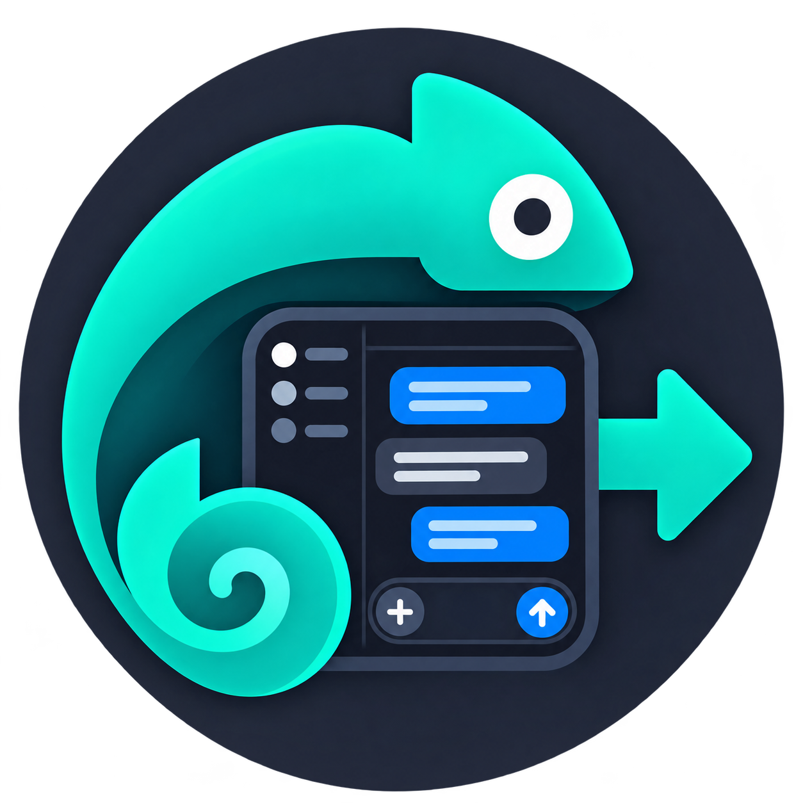

  
  <h1>ChatScribe</h1>
  
<strong>Copie ou exporte conversas do chatgpt.com.</strong> 
  Copie a conversa inteira, a resposta mais recente ou as mensagens que você selecionar.

  
Baixe em Markdown, texto, JSON ou CSV, ou salve uma exportação Markdown no GitHub.

  
<a href="https://chrome.google.com/webstore/detail/aapnhkibnnhppanchcfngalkkojjfcmf">Instale o ChatScribe na Chrome Web Store</a>

  
<a href="README.md">English</a> · <a href="README.zh-CN.md">简体中文</a> · <a href="README.zh-TW.md">繁體中文</a> · <a href="README_ja.md">日本語</a> · <a href="README_ko.md">한국어</a> · <a href="README_es.md">Español</a> · <a href="README_pt-BR.md">Português (Brasil)</a> · <a href="README_ru.md">Русский</a> · <a href="README_fr.md">Français</a> · <a href="README_de.md">Deutsch</a>

## Recursos

- Copie para a área de transferência a conversa inteira, a resposta mais recente do assistente ou as mensagens selecionadas.
- Selecione mensagens individualmente. Filtre por usuário ou assistente, selecione todas ou nenhuma, inverta a seleção e expanda as prévias.
- Exporte a conversa inteira ou as mensagens selecionadas para Markdown, texto, JSON ou CSV.
- Se quiser, baixe imagens da conversa — incluindo imagens geradas disponíveis na página — e agrupe-as com o Markdown em um ZIP. O Markdown aponta para as imagens por caminhos relativos.
- Nas exportações Markdown, modelos de diagramas SVG compatíveis são convertidos em imagens PNG. No texto, eles aparecem como `[Diagram]`; modelos incompatíveis permanecem como estão.
- Salve uma exportação Markdown no diretório `exports/` do repositório GitHub que você escolher. Se houver imagens, o arquivo será salvo como ZIP.
- Configure o tema, o idioma da interface, os títulos e o espaçamento das mensagens, a data e hora da exportação, a confirmação de download e o empacotamento de imagens.

A interface está disponível em inglês, chinês, alemão, espanhol, francês e russo. O idioma do navegador é detectado automaticamente; se não houver suporte, a interface usa inglês.

## Instalação a partir do código-fonte

Use Node.js 22 e npm.

### Chrome

~~~sh
npm ci
npm run build:chrome
~~~

Abra `chrome://extensions`, ative o modo do desenvolvedor, escolha **Load unpacked** e selecione o diretório `dist/` gerado. Consulte o [guia do Chrome para carregar uma extensão descompactada](https://developer.chrome.com/docs/extensions/get-started/tutorial/hello-world).

### Firefox

É necessário usar Firefox 140 ou posterior no computador e Firefox para Android 142 ou posterior.

~~~sh
npm ci
npm run build:firefox
~~~

Abra `about:debugging`, escolha **This Firefox** e **Load Temporary Add-on**, e selecione `dist-firefox/manifest.json`. O Firefox remove complementos temporários ao ser reiniciado. Consulte o [guia de instalação temporária da Mozilla](https://extensionworkshop.com/documentation/develop/temporary-installation-in-firefox/).

A compilação do Chrome é gerada em `dist/` e a do Firefox em `dist-firefox/`; os diretórios são independentes.

## Verificações de desenvolvimento

~~~sh
npm run typecheck
npm run test:run
npm run build
~~~

O fluxo de CI executa essas verificações com Node.js 22. Para gerar uma extensão específica para um navegador, use `npm run build:chrome` ou `npm run build:firefox`.

## Privacidade

A extensão processa o conteúdo da conversa para realizar a ação que você escolheu. O conteúdo só é enviado ao GitHub quando você decide explicitamente salvá-lo lá. Consulte a [política de privacidade](docs/privacy-policy.md); antes da publicação, hospede-a em uma URL pública e mantenha o texto alinhado às práticas de dados da extensão.

## Agradecimentos

O ChatScribe é desenvolvido de forma independente. A ideia do projeto foi inspirada pelo [AI Exporter, de Grant Totinov](https://github.com/GrantTotinov/AIExporter); agradeço a Grant. O ChatScribe não depende do código-fonte do AI Exporter, não é afiliado nem endossado oficialmente por Grant Totinov, ChatGPT ou OpenAI e não é um produto oficial de nenhum deles.

## Licença

O software original do ChatScribe é licenciado sob a [PolyForm Noncommercial License 1.0.0](LICENSE). Ela permite usos não comerciais, incluindo usos pessoais, de pesquisa e educacionais; o uso comercial exige uma autorização separada do titular dos direitos autorais. Dependências e recursos de terceiros continuam sujeitos às respectivas licenças. Esta é uma licença de código disponível para uso não comercial, não uma licença de código aberto segundo a definição da OSI.
